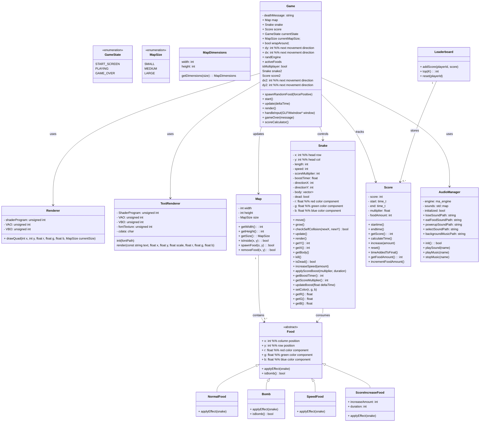

# PA5-Snake
-----------------------------------------
T-403-FORC - group 27

Students:
- Brynhildur Þorbjörg Þórhallsdóttir 
- Herdís Heiða Jing Guðjohnsen
- Sara Elísabet Jónsdóttir

Teachers:
- Atli Fannar <atlif@ru.is>
- Konráð Elí <konrad21@ru.is>
- Teitur Hrólfur <teitur23@ru.is>
------------------------------------------

# Table of Content

- [Setup](#setup)
  - [Libraries Required](#libraries-required)
  - [For macOS](#for-macos)
  - [For Linux/Windows](#for-linuxwindows)
  - [Install GLFW Manually](#install-glfw-manually)

- [How to Play the Game](#how-to-play-the-game)
  - [Compiling the Game](#compiling-the-game)
  - [Running the Game](#running-the-game)
  - [Clean Compiled Files](#clean-compiled-files)

- [Files and Class Diagram](#files-and-class-diagram)
  - [File Structure](#file-structure)
  - [Class Diagram](#class-diagram)

------------------------------------------

# Setup

## Libraries required
- OpenGL (version 4.1+)
- A graphics driver that supports OpenGL 4.1+ (usually already installed)

### For macOS
- glfw (for graphics rendering)
```bash
brew install glfw
```
<em>Note: macOS supports up to OpenGL 4.1 maximum.</em>

### For Linux
- audio library (miniaudio)
```bash
sudo apt install pulseaudio pulseaudio-utils alsa-utils
sudo apt install libasound2-dev
```
- libglfw3 (for graphics rendering)
```bash
sudo apt update
sudo apt install libglfw3 libglfw3-dev
```


#### Install GLFW manually
If you are on windows or if you prefer to install GLFW manually, you can follow these steps:

1. Download GLFW package from https://www.glfw.org/download.html according to your operating system.
2. Locate the `lib` folder inside it and copy the `libglfw3` file to the root directory of this project (replace the existing one if it exists).

------------------------------------------

# How to play the game

## Compiling the game

1. Go to the root directory of the project
```bash
cd path/to/PA5-Snake
```

2. Compile the code using the Makefile:
```bash
make
```

Then we have executable file:
| mac /linux        | windows            |
| ----------------- | ----------------- |
| `Snake.out`       | `Snake.exe`       |

## Running the game

3. Run the executable:
| mac /linux        | windows            |
| ----------------- | ----------------- |
| `./Snake.out`     | `./Snake.exe`     |


<br><em>Note2: on Mac, to have the screen size fit properly, you may need to adjust the window size manually after launching the game</em>


## Clean compiled files
```bash
make clean
```


---------------------------------------------------


# Files and Class Diagram


## File structure
```bash
SnakeGame/ 
│
├── main.cpp
│
├── Game.hpp / Game.cpp
├── Snake.hpp / Snake.cpp
├── Map.hpp / Map.cpp
│
├── Food.hpp / Food.cpp
├── NormalFood.hpp
├── SpecialFood.hpp
│
├── Score.hpp / Score.cpp
├── Leaderboard.hpp / Leaderboard.cpp
│
├── AudioManager.hpp / AudioManager.cpp
│
├── Renderer.hpp / Renderer.cpp
├── TextRenderer.hpp / TextRenderer.cpp
│
├── glad/                   # OpenGL loader
├── GLFW/                   # GLFW header files
├── KHR/                    # OpenGL header files
├── stb_truetype.h          # font rendering library
├── miniaudio_impl.cpp / miniaudio.h  # audio rendering library

lib/ 
│
├── libglwf3.dylib  # mac
├── libglwf3.dll.a  # windows

assets/ 
│
├── all assets (audio, etc.)

root-directory/ 
│
├── Micro5-Regular.ttf  # font for text rendering
├── README.md
├── Makefile
```


## Class Diagram

