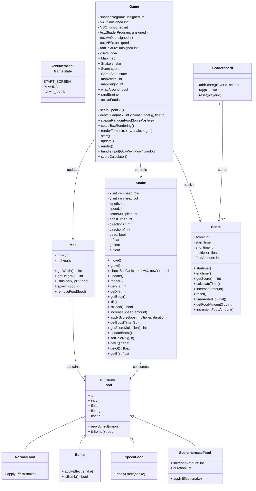

# PA5-Snake
We are going to implement the classic Snake game using OpenGL.

-----------------------------------------
Students:
- Brynhildur Þorbjörg Þórhallsdóttir 
- Herdís Heiða Jing Guðjohnsen
- Sara Elísabet Jónsdóttir


<!-- // bara var á töflunni -->
#T-403-FORC - group 27

Teachers:
- Atli Fannar <atlif@ru.is>
- Konráð Elí <konrad21@ru.is>
- Teitur Hrólfur <teitur23@ru.is>

<!-- ps- það er fyrir neðan
#compile/run
""" 
cd build
cmake ..
cmake -- build
""" -->

------------------------------------------


## Compilation and Running the Game!!

### Libraries required:
- OpenGL (at least ver 4.1)
- glfw (mac: `brew install glfw`) (TODO brynhildur/SARA ég vtk hvað þið þurftuð að download-a)

### Before compiling:

1. Download GLFW package from https://www.glfw.org/download.html according to your operating system.
2. Locate the `lib` folder inside it and copy the `libglfw3` file to the root directory of this project (replace the existing one if it exists).

### Compile walk through:
| mac               | windows           |
| ----------------- | ----------------- |
| `cmd + shift + B` | `ctr + shift + B` |

or use `make` command in terminal


Then we have executable file:
| mac               | windows           |
| ----------------- | ----------------- |
| `Snake.out`       | `Snake.exe`       |


### Run game:
| mac               | windows           |
| ----------------- | ----------------- |
| `./Snake.out`     | `./Snake.exe`     |

<em>Note: the program might not detect the correct OS, therefore the executable name might still be `Snake.out` even though you are on Windows</em>


### Clean compiled files:
```bash
make clean
```


---------------------------------------------------


# Files and Class Diagram


## File structure:
```bash
SnakeGame/ 
│
├── main.cpp
│
├── Game.h / Game.cpp
├── Snake.h / Snake.cpp
├── SnakeSegment.h
├── Map.h / Map.cpp
│
├── Food.h / Food.cpp
├── NormalFood.h
├── SpecialFood.h
│
├── Score.h / Score.cpp
├── Leaderboard.h / Leaderboard.cpp
│
├── glad/           # OpenGL loader
├── GLFW/           # GLFW header files
├── KHR/            # OpenGL header files
├── stb_truetype.h  # font rendering

lib/ 
│
├── libglwf3.dylib  # mac
├── libglwf3.dll.a  # windows

root-directory/ 
│
├── Micro5-Regular.ttf  # font for text rendering
├── README.md
├── Makefile
```


## Class Diagram:
