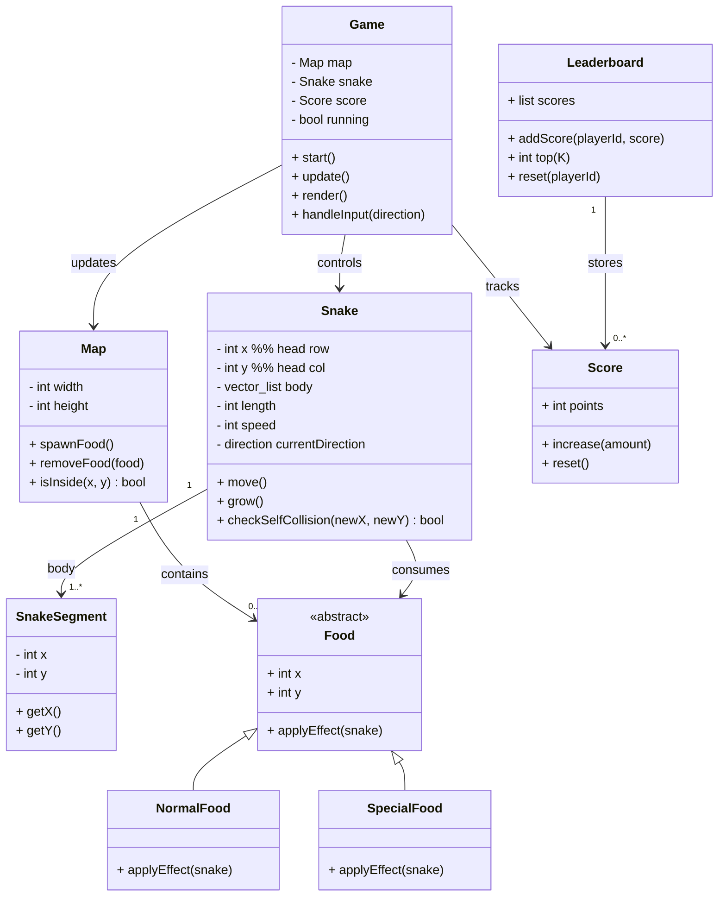

# PA5-Snake
We are going to implement Snake using OpenGL

**breyta öllu skjalinu eftir Nýja verkefninu**

-----------------------------------------
Students:
- Brynhildur Þorbjörg Þórhallsdóttir 
- Herdís Heiða Jing Guðjohnsen
- Sara Elísabet Jónsdóttir

------------------------------------------

**We used inheretance while implementing our game**
- the player character and enemy are subclasses to the class Creature

------------------------------------------

**What we implemented in our game!** 
- main criteria 50%
    - Added enemie with stats to the game
    - Have a playable main character
    - Added a turn based battle cycle
    - Added health, attack and defence to each character
    - allow the user to take actions with standard in and out

- Extra spice! (Idk how much % these things give but here you go)
    - have 3 enemies (each one of our teachers)
    - Added ascii art of not only the teachers but also us into the game
    - Added a title screen, a story segment and endings! (with ascii)
    - Have two different playable characters, who each have different stats (Brynhildur and Sara, the best students in the world!!!!) 
    - Added rest stops between battles to boost stats before next battle
    - Added special attacks to each character
    - Desplay nessesery information, like how much the player has left in their healing

-------------------------------------------

## Compilation and Running the Game!!

# Compile walk through:
| mac               | windows           |
| ----------------- | ----------------- |
| `cmd + shift + B` | `ctr + shift + B` |


Then we have executable file:
- `Snake.out`

# Run game:
```bash
./Snake.out
```

# Clean compiled files:
```bash
make clean
```

------------------------------------------------

# All the Files Included in the Submission
- **Header files**: `Creature.hpp`, `Enemy.hpp`, `GameCycle.hpp`, `GameManager.hpp`, `Player.hpp`
- **Implementation files**: `Creature.cpp`, `Enemy.cpp`, `GameCycle.cpp`, `GameManager.cpp`, 
    `JRPG.cpp`, `Player.cpp`, 
- **Text files**: `boss0.txt`, `boss1.txt`, `boss2.txt`, `protag0.txt`, `protag1.txt`, `storySetting.txt`, `titleScreen.txt`, `enemyBeaten.txt`, `goodEnd.txt`, `badEnd.txt`

- **Build system**: `Makefile`
- **Documentation**: `README.md`


Hope you guys like the game! must be weird being a bad guy huh? （；´д｀）ゞ
Tried our best at least hope it actually runs well and isisnt too dificult ᕦ(ò_óˇ)ᕤ

---------------------------------------------------


#### TODO BREYTA


SnakeGame/
│
├── main.cpp
│
├── Game.h / Game.cpp
├── Snake.h / Snake.cpp
├── SnakeSegment.h
├── Map.h / Map.cpp
│
├── Food.h / Food.cpp
│
├── Score.h / Score.cpp
├── Leaderboard.h / Leaderboard.cpp
│
├── Renderer.h / Renderer.cpp
 ├─ drawSnake()
 ├─ drawFood()
 └─ drawMap()


